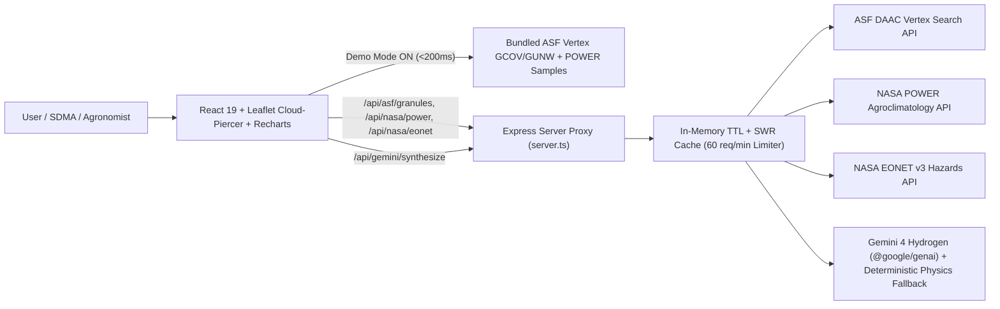

# 1. Project Title & Problem Statement

**Radar Rhythm: Cloud-Piercing Satellite Radar Maps for Floods, Farms, and Faults**

> *"Earth's surface is an endless dance of natural processes and human activities, but these changes are often difficult to visualize, understand, and communicate. From wetland loss to forest wildfires, earthquakes, farming activities, glacier movement, and more, Earth is in a constant waltz of surface changes. Your challenge is to build an interactive application that uses radar remote sensing data from the NASA-ISRO Synthetic Aperture Radar (NISAR) mission to track and visualize one or more types of surface change at locations around the world."*

Optical Earth observation satellites fail during dense monsoon cloud cover and night-time disasters. **Radar Rhythm** decodes L-band (24 cm wavelength) dual-polarimetric **GCOV** (water and crop radar in $\gamma^0$ dB) and **GUNW** (ground movement radar in cm and coherence $\gamma$) products from the Alaska Satellite Facility (ASF DAAC) into an interactive 3D Earth + 2D Satellite & Radar comparison explorer.

---

# 2. Team Details

- **Aman Kawale** (`smian087`) — Frontend Architecture & Interactive GIS UI
- **Vedant Jaiswal** (`vedantjaiswal-dot`) — Product Strategy, Story Presets & Live Demo Lead
- **Kalash Wasad** (`kalash-tech`) — Backend Proxy, ASF/NASA APIs & Caching Engine
- **Humaira Khan** (`Humairakhan1804`) — SAR GCOV/GUNW Data Pipeline & Geospatial Layers
- **Asawari Dhawad** (`dhawadasawari1904-hash`) — Gemini Synthesis, Telemetry Analytics & Multilingual UX

---

# 3. Solution Overview & Architecture



### Technology Stack
- **Frontend**: React 19, TypeScript, Tailwind CSS v4, Leaflet (`react-leaflet`), Recharts, Lucide Icons
- **Backend**: Node.js, Express, `@google/genai` (`gemini-4-hydrogen`), in-memory TTL + stale-while-revalidate cache, IP rate limiter
- **Open Earth Data**: NASA-ISRO NISAR (`GCOV` / `GUNW`), ASF DAAC Vertex API, NASA GIBS MODIS Terra TrueColor WMTS, NASA POWER Agroclimatology API, NASA EONET v3

---

# 4. Live Demo & Screenshots

- **Study Area 1 — Maharashtra, India (`maharashtra_gcov`)**: Gosikhurd Dam & Wainganga floodplain specular reflection (`HH = -21.4 dB`) and Wardha Bt Cotton / Bhandara paddy canopy volume (`HV = -11.2 dB`).
- **Study Area 2 — Northeast India (`northeast_india_gcov`)**: Brahmaputra & Kaziranga floodplain piercing 100% monsoon cloud cover with `142 mm/day` NASA POWER rainfall correlation.
- **Study Area 3 — Japan (`japan_gunw`)**: Noto Peninsula & Toyama Bay co-seismic uplift (`+4.2 cm`), fault rupture subsidence (`-18.6 cm`), and interferometric coherence masking (`γ` slider).
- **90-Second Demo Flow**:
  1. Drag the **Cloud-Piercer Split Slider** over Maharashtra to reveal flooded channels beneath monsoon cloud cover.
  2. Switch to Northeast India and scrub across the **4-Pass Orbital Timeline** (`Pass 1` → `Pass 4`).
  3. Switch to Japan GUNW, adjust the Coherence (`γ`) mask, and run **Synthesize Physical Drivers** in English, Marathi, or Hindi.

---

# 5. Installation & Setup Guide

```bash
# 1. Install dependencies
npm install

# 2. Configure optional environment variables (.env)
cp .env.example .env
# Add GEMINI_API_KEY and optional NASA_API_KEY

# 3. Run unit tests
npx --yes tsx --test src/utils/sarPhysics.test.ts

# 4. Start unified Express + Vite dev server on port 3000
npm run dev

# 5. Production build & start (Cloud Run)
npm run build
npm start
```

### Local NISAR HDF5 (.h5) Granule Extraction
Raw NISAR L2 GCOV HDF5 granules exceed GitHub's 100 MB file limit. Use `scripts/extract_nisar_h5.py` (`h5py` + `numpy`) locally to extract `10 * log10(gamma0)` decibel statistics from `/science/LSAR/GCOV/grids/frequencyA/HHHH`, `/science/LSAR/GCOV/grids/frequencyA/HVHV`, and `/science/LSAR/identification/boundingPolygon` into lightweight GeoJSON:
- **Maharashtra**: `NISAR_L2_PR_GCOV_035_084_A_013_4005_DHDH_A_20261111T001915_20261111T001949_P05036_N_F_J_001.h5` (Cycle 035, Track 084, Frame 013, Ascending, 40+5 MHz, DHDH, CRID `P05036`)
- **Northeast India**: `NISAR_L2_PR_GCOV_035_098_A_013_4005_DHDH_A_20261111T233738_20261111T233812_P05036_N_F_J_001.h5` (Cycle 035, Track 098, Frame 013, Ascending, 40+5 MHz, DHDH, CRID `P05036`)
- **Japan**: `NISAR_L2_PR_GCOV_035_009_A_024_4005_DHDH_A_20261105T193406_20261105T193442_P05036_N_F_J_001.h5` (Cycle 035, Track 009, Frame 024, Ascending, 40+5 MHz, DHDH, CRID `P05036`)

```bash
python3 scripts/extract_nisar_h5.py --input-dir ./raw_nisar_h5 --output ./src/data/samples/extracted_nisar_gcov.geojson
```

---

# 6. AI Usage Disclosure

NISAR Pulse uses Google `@google/genai` (`gemini-4-hydrogen`, server-side only) exclusively in the **Physical Driver Synthesizer** (`POST /api/gemini/synthesize`) to translate structured GCOV/GUNW telemetry and NASA POWER metrics into grounded physical explanations and field advisories in English, Marathi, and Hindi. When `GEMINI_API_KEY` is absent or offline, the backend automatically executes a deterministic microwave physics fallback (`buildDeterministicSynthesis`). All AI-assisted engineering activities are documented in `AI_USAGE_LEDGER.md`.

Built with open NASA & ISRO NISAR / ASF / Earthdata / GIBS / POWER data. NASA does not endorse this application.

